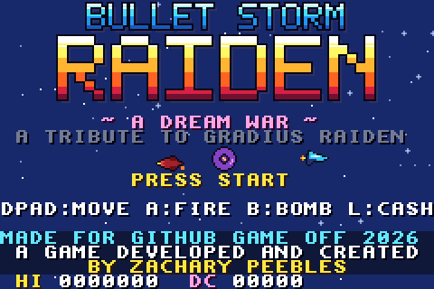
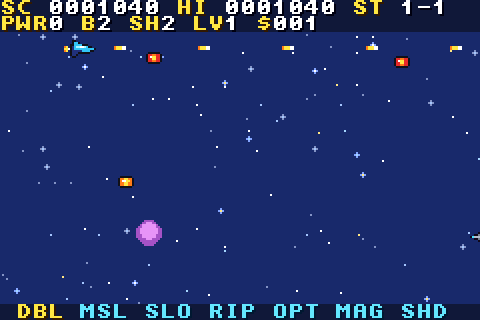
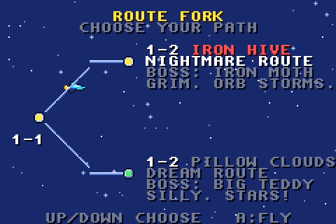
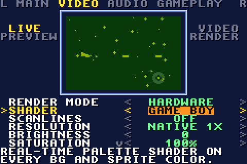
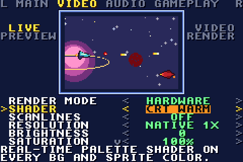

# Bullet Storm Raiden

**A roguelite horizontal shoot-'em-up for the Game Boy Advance.**
Made for **[GitHub Game Off 2026](https://itch.io/jam/game-off-2026)** (theme: **SHIFT**).
A game developed and created by **Zachary Peebles**.

  

## The story
Milo, a kid with a big imagination, dreams up a squadron to guard his sleep. Then the Nightmare gets in.
Every stage **shifts** between the grim nightmare and the silly dream fighting back: serious Gradius-style stages one moment, Parodius-style chaos the next.

## Features
- **Branching routes:** a Darius-style fork after every level and sub-level, so no two runs play the same.
- **7-slot power meter:** pick slot 1 yourself; slots 2-7 roll randomly every run from power-ups, ship upgrades and tweaks. Press L to cash in.
- **Roguelite runs:** relics from bosses, shops and random events between stages, dream coins and unlocks that carry over.
- **Ships:** NX-7 Nightjet, Paper Dream, Sgt. Waddles, and the unlockable Toast-R (10+ planned).
- **Four difficulties:** Easy, Normal, Hard, and Extreme, an adaptive rank that climbs while you survive.
- **Original chiptune soundtrack** with dream and nightmare versions of each theme.
- **Game Settings** (v0.2): in-game video and audio options with a live preview.
- Battery save (SRAM).

 

## Play it
1. Download the newest ROM from [`releases/`](releases/) (currently `releases/v0.2/BulletStormRaiden_v0.2.gba`).
2. Open it in any GBA emulator (mGBA recommended, also Delta, RetroArch, Pizza Boy, myBoy) or put it on a flashcart.

| Action | GBA | mGBA keyboard (default) |
|---|---|---|
| Move | D-pad | Arrow keys |
| Fire (hold) | A | X |
| Bomb | B | Z |
| Cash in power meter | L | A |
| Pause | Start | Enter |

## Build from source
Requires the [Wonderful Toolchain](https://wonderful.asie.pl/) with `target-gba` and `target-gba-libtonc`, plus Python 3 + Pillow for the asset generators.

```sh
./setup-toolchain.sh                 # installs Wonderful Toolchain to /opt/wonderful
export PATH=/opt/wonderful/bin:$PATH
cd game && make clean && make dist   # writes dist/BulletStormRaiden_vX.Y.gba
```
See [`game/README.md`](game/README.md) for the code layout and headless testing.

## Project docs
- [ROADMAP.md](ROADMAP.md): milestones from the jam build to the full game
- [CHANGELOG.md](CHANGELOG.md): every version, what changed
- [docs/DEVLOG.md](docs/DEVLOG.md): the step-by-step development process
- [docs/design.md](docs/design.md): every design decision and why

## Development process and AI use
Game Off asks entrants to disclose AI use. Zachary Peebles directs the game's vision and makes every design decision. Code, pixel art, music and sound are produced with AI assistance (Hark) and generated by the scripts in `tools/`. All content is original; classic shooters are named only as inspiration.

## Credits and licenses
- Game by Zachary Peebles. Released under [CC0 1.0](LICENSE).
- [libtonc](https://github.com/gbadev-org/libtonc) and the Wonderful Toolchain, under their own licenses.
- The browser player uses [gbajs](https://github.com/endrift/gbajs) by Jeffrey Pfau (BSD 2-Clause) with an open-source replacement BIOS.
